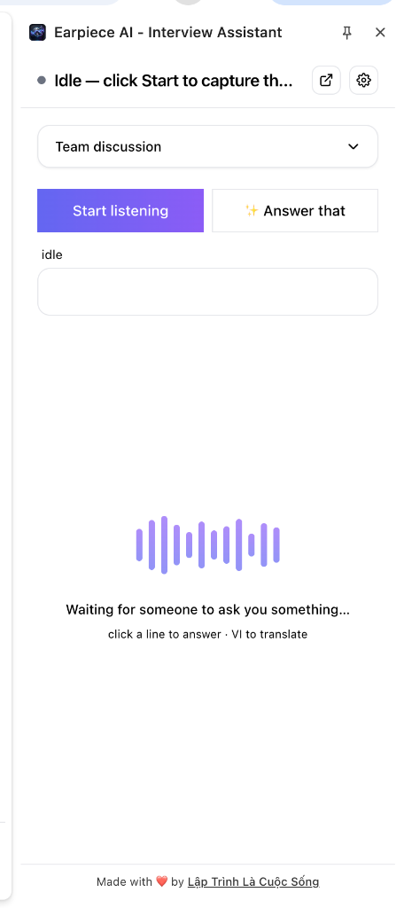

# Earpiece AI 🎧

> Your AI copilot in the call — live meeting transcription + AI answer suggestions for video call interviews on Google Meet, Zoom, and Microsoft Teams.

Earpiece AI is a Chrome extension (Manifest V3) that listens to your call, transcribes the other side in near-real time, and drafts short, spoken-style answer suggestions so you can respond faster and calmer in interviews and high-stakes meetings.

<p align="center">
  
</p>

## How it works

1. Open a meeting (Meet / Zoom / Teams) — click the Earpiece AI toolbar icon to open the **side panel**.
2. Pick a **context** from the dropdown (e.g. _Team discussion_, _Technical interview_, _Behavioral interview_) so the AI knows how to help.
3. Click **Start listening** — the extension captures the tab's audio (`chrome.tabCapture`), so it hears the *other side* only (your own mic is not duplicated).
4. Speech is transcribed in an offscreen document via the Web Speech API (free, no API key needed; supports `vi-VN`, `en-US`, `ja-JP`).
5. When the interviewer asks something, click the transcript line — or hit **✨ Answer that** — and an OpenAI-compatible API drafts a short answer you can copy or adapt.

## Features

- ✅ MV3 scaffold on [Jonghakseo's boilerplate](https://github.com/Jonghakseo/chrome-extension-boilerplate-react-vite) (React + Vite + Turborepo + Tailwind)
- ✅ Bilingual UI: English + Vietnamese (`click a line to answer · VI to translate`)
- ✅ Side panel opens on toolbar click (`openPanelOnActionClick`)
- ✅ Context dropdown — switch between _Team discussion_, _Technical interview_, _Behavioral interview_, etc.
- ✅ Live transcription (Web Speech API in offscreen document)
- ✅ AI answer suggestions via **✨ Answer that** button (bring your own OpenAI-compatible API key)
- ✅ Audio waveform animation while waiting for speech
- ✅ Manifest locked to meeting platforms only (no `<all_urls>`)
- 🔜 Session history + recap
- 🔜 Draggable in-page panel, Alt+I toggle, per-site position memory

## Privacy

- Audio is processed by Chrome's built-in speech engine (Web Speech API sends audio to Google's speech servers — see [Chrome docs](https://developer.chrome.com/docs/web-platform/speech-api)).
- Transcripts and questions are sent **only** to the API endpoint you configure (default `api.openai.com`). No telemetry, no third-party analytics.
- Session transcripts live in `chrome.storage.session` and are cleared when the browser closes. Settings (including your API key) stay in `chrome.storage.local` on your machine.

## Ethics

Earpiece AI is built as a **meeting and interview assistance tool** — drafting help, recaps, and clarifying questions, like a coach in your corner. Using live AI assistance in graded, proctored, or explicitly AI-banned interviews may violate the other party's expectations and terms. You are responsible for how you use it.

## Permissions rationale

| Permission | Why |
|---|---|
| `storage` | Save settings, API key, panel position, session transcripts |
| `tabCapture` | Capture meeting tab audio (the interviewer's side) |
| `offscreen` | Run the Web Speech API — it needs a DOM, which the MV3 service worker lacks |
| `sidePanel` | Chrome side panel UI (main interface) |

Content scripts are injected **only** into `meet.google.com`, `zoom.us`, and `teams.microsoft.com`.

## Development

```bash
pnpm install
pnpm build        # production build → dist/
pnpm dev          # watch mode (reload the extension in chrome://extensions after changes)
pnpm zip          # pack dist/ → dist-zip/extension-*.zip
pnpm type-check   # tsc -b across all packages
```

**Load unpacked:** `chrome://extensions` → Developer mode → *Load unpacked* → select `dist/`.

### Project structure

```
chrome-extension/        # manifest.ts + service worker (background)
pages/                   # extension pages (side-panel, options, content-ui, offscreen, ...)
packages/                # shared libs (storage, i18n, ui, vite-config, ...)
```

See `AGENTS.md` for the full development guide and architecture conventions.

## Firefox

Not supported. `tabCapture` and offscreen documents are Chromium-only APIs.

## Credits

Made with ❤️ by [Lập Trình Là Cuộc Sống](https://www.youtube.com/@LapTrinhLaCuocSong)

## License

MIT
